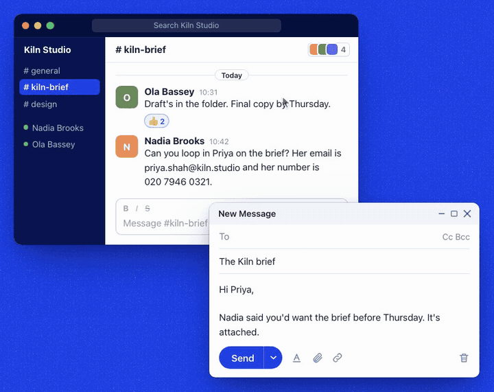

<p align="center"></p>

<p align="center"><b>Copy a whole message. Paste only the part that fits the field.</b></p>

<p align="center">
  <a href="https://github.com/hridaya423/cue/releases/latest"></a>
  
  
  
</p>

<p align="center">
  <a href="https://github.com/hridaya423/cue/releases/latest/download/Cue.dmg"><b>Download for Mac</b></a>
  &nbsp;·&nbsp;
  <a href="https://cue.hridya.tech">cue.hridya.tech</a>
</p>

<p align="center"></p>

Cue is a clipboard for macOS. It keeps your clipboard history. When you paste, Cue reads the focused field and asks a decision model which clip fits. In the demo, the To field asks for an email, so Cue pastes only the address from the copied message.

The model only chooses among your real clips. It never writes text. If no model runs, or the endpoint does not answer, the paste is a plain ⌘V.

Inspired by [@marcus_lowe's demo](https://x.com/marcus_lowe/status/2101476399488160013), rebuilt as a real background app.

## Install

1. Download [Cue.dmg](https://github.com/hridaya423/cue/releases/latest/download/Cue.dmg) and drag Cue to Applications.
2. Open Cue. It lives in the menu bar.
3. Grant Accessibility when macOS asks. Cue uses it to read the focused field and to post the paste keystroke.
4. Pick a model in onboarding. You can change it later in Settings.

Cue needs macOS 15 or later.

## Shortcuts

| Shortcut | Action |
|---|---|
| ⌃⌥V | Smart paste |
| ⌃⌥⇧V | Plain paste |
| ⌃⌥C | Search history |
| ⌃⌥Q | Turn the queue on or off |
| ⌃⌥, | Open Settings |

Turn on ⌘V interception to make every ⌘V a smart paste. Cue registers ⌘V only while it has Accessibility access. You can change every shortcut in Settings.

- **Form fill**: Cue pastes, presses Tab and decides again, until the form is complete. Esc stops it.
- **Queue**: copies go into a queue, and each paste takes the oldest one.
- **Menu bar**: recent clips, search and one-click paste.

## How Cue decides

1. Cue polls `NSPasteboard` for text and URLs. History is a JSON file with a cap. Pinned clips stay.
2. On a smart paste, Cue reads the focused element through the Accessibility API: the app, the window title, the field's role, label, placeholder and value, the caret and nearby text.
3. Cue builds the options: the last 20 clips plus pins. An email, phone number, URL or code inside a clip becomes its own option.
4. One call to `POST {base}/v1/systemone` asks all questions in parallel.
5. A decisive pick pastes. If the model has no clear leader, a chooser opens at the caret with up to nine rows. Esc or ⌘V gives a plain paste.

Some pastes need no model call. If the field asks for an email, a phone number or a URL and exactly one option matches, Cue pastes that option. On ⌘V, if the latest clip already fits the field, Cue pastes it directly.

## Models

Every provider uses the same client with a different URL, model and key.

| Provider | Endpoint | Model |
|---|---|---|
| Jev, TypeSafe direct | `api.typesafe.ai`, key `TYPESAFE_API_KEY` | `jev-latest` |
| Jev, AI Gateway | `ai-gateway.vercel.sh/typesafe`, key `AI_GATEWAY_API_KEY` | `typesafe-ai/jev` |
| Local | A server that Cue installs and runs on your Mac | JevK5-Lite is recommended |
| Custom | Any server that answers `POST {base}/v1/systemone` | Your choice |
| Off | No model calls. Every smart paste is a plain paste. | None |

The local catalog is ranked by benchmark and shows the disk size and memory for each variant. Cue installs the model, downloads the weights and runs the server. Two examples:

- [Kev](https://github.com/jaredpalmer/kev): LoRA adapters on Qwen3.5 in four sizes (0.8B to 9B), served on port 8009.
- [Laya](https://github.com/convaiinnovations/laya): a 421M encoder at about 33 ms, served by a bundled stdlib shim on port 8765.

## Privacy

- Cue never reads password fields and never sends them anywhere.
- Before clip text goes to a remote provider, an on-device model (desert-ant `redact`, about 12 MB of Core ML) replaces names, emails, phone numbers, cards and IDs with placeholders. Redaction is on by default for remote providers and off for local ones.
- If redaction fails, Cue does a plain paste. It never sends raw text instead.
- Redaction changes only what the model sees. The paste uses your real clip.
- Image and file copies pass through untouched.
- API keys stay in the Keychain. History is plain JSON in `~/Library/Application Support/Cue/`.

## Build from source

Building needs Xcode 26. Cue has one dependency, `desert-ant-core`, for the redaction model.

```sh
Scripts/bundle.sh        # builds build/Cue.app
open build/Cue.app
swift test
```

`Scripts/release.sh` builds a signed, notarized DMG at `build/Cue-<version>.dmg`. If an ad-hoc rebuild loses the Accessibility grant, run `tccutil reset Accessibility com.hridyaagrawal.cue`.

`CueEval` runs 110 synthetic cases through the real decision engine:

```sh
swift build -c release --product CueEval
.build/release/CueEval --cases Evals/cases.jsonl --endpoint name=base,model --repeats 3 --json out.json
```

`--replay <raw.jsonl>` scores recorded answers again with the current policy, with no server. `--diag` prints the model's leader beside the context signal for each case.

`Sources/CueKit/` holds the app, and `AGENTS.md` lists its invariants. In Settings, General, **Run self-check** pastes into a real text field and checks the result. The website lives in `web/`.
